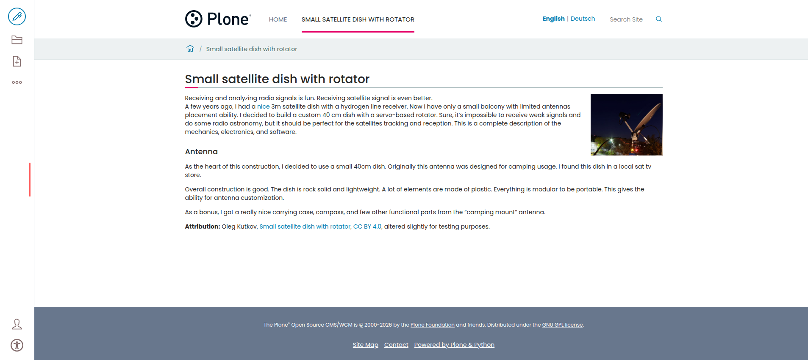
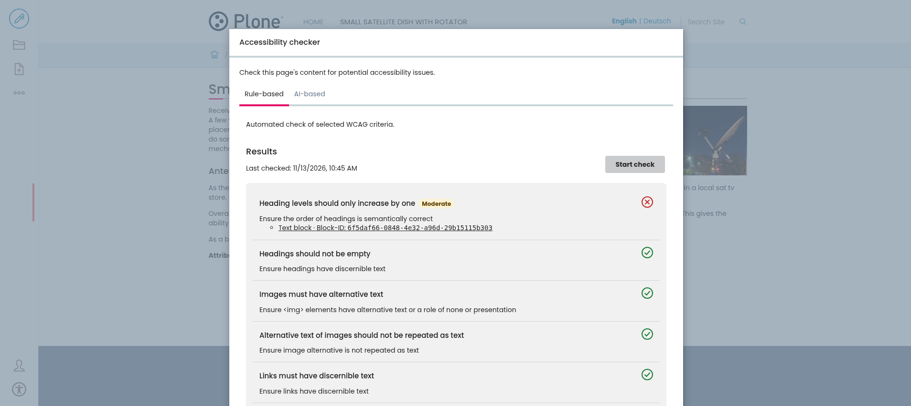
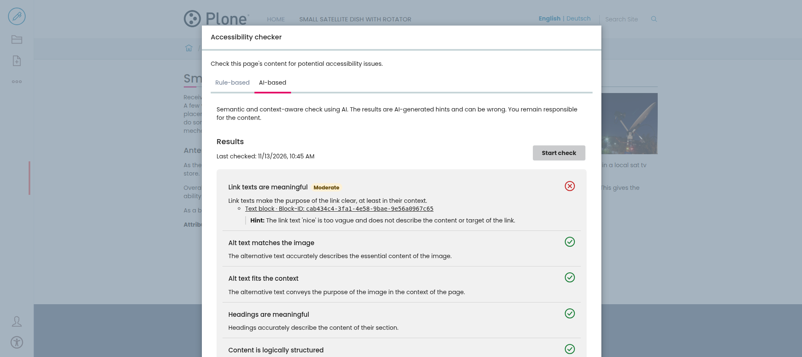

# Interaktiv Accessibility Checker (@interaktivgmbh/volto-accessibility-checker)

[](https://www.npmjs.com/package/@interaktivgmbh/volto-accessibility-checker)
[](https://github.com/interaktivgmbh/volto-accessibility-checker/actions/workflows/main.yml)

Integrated accessibility checker for Volto.

This add-on lets editors check a page for accessibility issues right from the toolbar.
It combines a rule-based check with [axe-core](https://github.com/dequelabs/axe-core) and an AI-based check that
finds issues rules can't detect, like alt texts that don't match the image.
Every issue links to the affected block, so editors can fix it right away.

## Prerequisites

Tested with Volto 18 and 19.

The rule-based check runs entirely in the browser and works without any
backend add-on. The AI-based check needs the backend add-on
[interaktiv.accessibilitychecker](https://github.com/interaktivgmbh/interaktiv.accessibilitychecker).
Without it, the AI tab is disabled.

## Features

Editors see an accessibility button at the bottom of the toolbar on pages
they're allowed to edit. It opens a dialog with two tabs:

* **Rule-based** checks the rendered page with axe-core against selected WCAG
  rules, such as missing alt texts, empty links and headings, wrong heading
  order and table headers.
* **AI-based** sends the page content to the backend, where an AI checks it
  against criteria like meaningful alt texts, link texts and headings, and a
  logical structure. The results are AI-generated hints and can be wrong.

By default, the rule-based check uses these axe-core rules. Rules marked as
best practice aren't required by WCAG, but axe-core recommends them:

| Rule                  | Description                                                                       | WCAG                                       |
|-----------------------|-----------------------------------------------------------------------------------|--------------------------------------------|
| `image-alt`           | Images must have alternative text                                                 | 1.1.1 Non-text Content                     |
| `link-name`           | Links must have discernible text                                                  | 2.4.4 Link Purpose, 4.1.2 Name, Role, Value |
| `td-headers-attr`     | Table cell headers attributes must refer to other `<th>` elements in the same table | 1.3.1 Info and Relationships             |
| `th-has-data-cells`   | Table headers in a data table must refer to data cells                            | 1.3.1 Info and Relationships               |
| `heading-order`       | Heading levels should only increase by one                                        | Best practice                              |
| `empty-heading`       | Headings should not be empty                                                      | Best practice                              |
| `image-redundant-alt` | Alternative text of images should not be repeated as text                         | Best practice                              |
| `empty-table-header`  | Table header text should not be empty                                             | Best practice                              |
| `scope-attr-valid`    | scope attribute should be used correctly                                          | Best practice                              |

The criteria of the AI-based check are listed in the README of
[interaktiv.accessibilitychecker](https://github.com/interaktivgmbh/interaktiv.accessibilitychecker#features).

**Checks can only be started in view mode, since they run on the rendered page.**

Each result shows whether the criterion passed, failed or needs a manual
review. Failed results come first, ordered by severity. They list the affected
blocks, and **Go to block** closes the dialog and moves the focus to that block.
The AI check also adds a short hint per block that explains the issue.

For example, this test page has a skipped heading level and a vague link text:



The rule-based check reports the skipped heading level and links to the
affected text block:



The AI-based check finds the vague link text, which rules can't judge:



*The test page uses content from [Small satellite dish with rotator](https://olegkutkov.me/2021/02/11/small-satellite-dish-with-rotator/)
by Oleg Kutkov ([license](https://olegkutkov.me/license/)), licensed under
[CC BY 4.0](https://creativecommons.org/licenses/by/4.0/), altered slightly for testing purposes.*

Results are kept per page until the browser is reloaded, so editors can switch
between pages and come back to them.

The add-on is translated into English and German. The axe-core messages
follow the current language, too.

### Configuration

You can change the content types and the axe-core rules in your project's
configuration:

```js
config.settings.accessibilityChecker = {
  ...config.settings.accessibilityChecker,
  contentTypes: ['Document', 'Plone Site', 'News Item'],
  axeRules: ['image-alt', 'link-name', 'heading-order'],
};
```

* `contentTypes` - the content types that show the accessibility button.
  Defaults to `Document`, `Plone Site` and `LRF`.
* `axeRules` - the [axe-core rule IDs](https://github.com/dequelabs/axe-core/blob/develop/doc/rule-descriptions.md)
  used by the rule-based check.

## Adding this add-on to your project

Add the add-on to your `package.json`:

```json
"dependencies": {
    "@interaktivgmbh/volto-accessibility-checker": "^1.0.0"
}
```

Then add it to the `addons` in your `volto.config.js`:

```js
const addons = ['@interaktivgmbh/volto-accessibility-checker'];
```

> [!IMPORTANT]
> Add this add-on as the **last** entry in `addons`. To find the block of a
> rule-based result, it wraps the views of all blocks that are registered
> before it. Results for blocks of add-ons that come later can't be linked to
> their block.

Finally, install the dependencies:

```shell
pnpm install
```

### Install from source

You can also install the add-on from the source with `mrs-developer`. In your
`mrs.developer.json` file, add:

```json
{
  "volto-accessibility-checker": {
    "output": "packages",
    "package": "@interaktivgmbh/volto-accessibility-checker",
    "url": "git@github.com:interaktivgmbh/volto-accessibility-checker.git",
    "https": "https://github.com/interaktivgmbh/volto-accessibility-checker.git",
    "path": "packages/volto-accessibility-checker/src",
    "tag": "v1.0.0"
  }
}
```

Use `"workspace:*"` as the version in your `package.json`, and make sure your
`pnpm-workspace.yaml` includes the nested package:

```yaml
packages:
  - 'core/packages/*'
  - 'packages/*'
  - 'packages/**/packages/*'
```

Then add the add-on to your `volto.config.js` as shown above and run:

```shell
make install
```

## Contribute

- [Issue tracker](https://github.com/interaktivgmbh/volto-accessibility-checker/issues)
- [Source code](https://github.com/interaktivgmbh/volto-accessibility-checker/)

Run `make help` to see the commands for development, such as `make install`,
`make start`, `make test` and `make lint`.

> [!NOTE]
> The unit tests need Volto 19, because they use its Vitest configuration.
> The development setup in this repository already uses Volto 19.

## License

The project is licensed under the MIT license.
